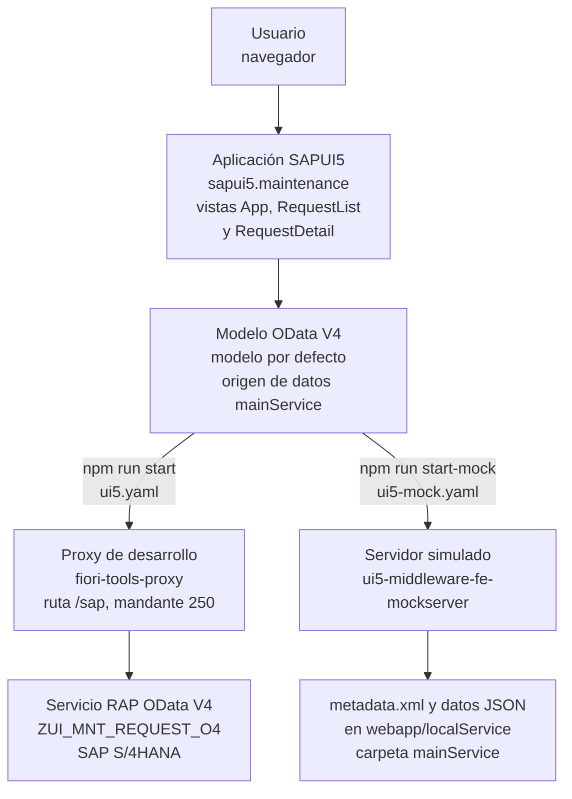
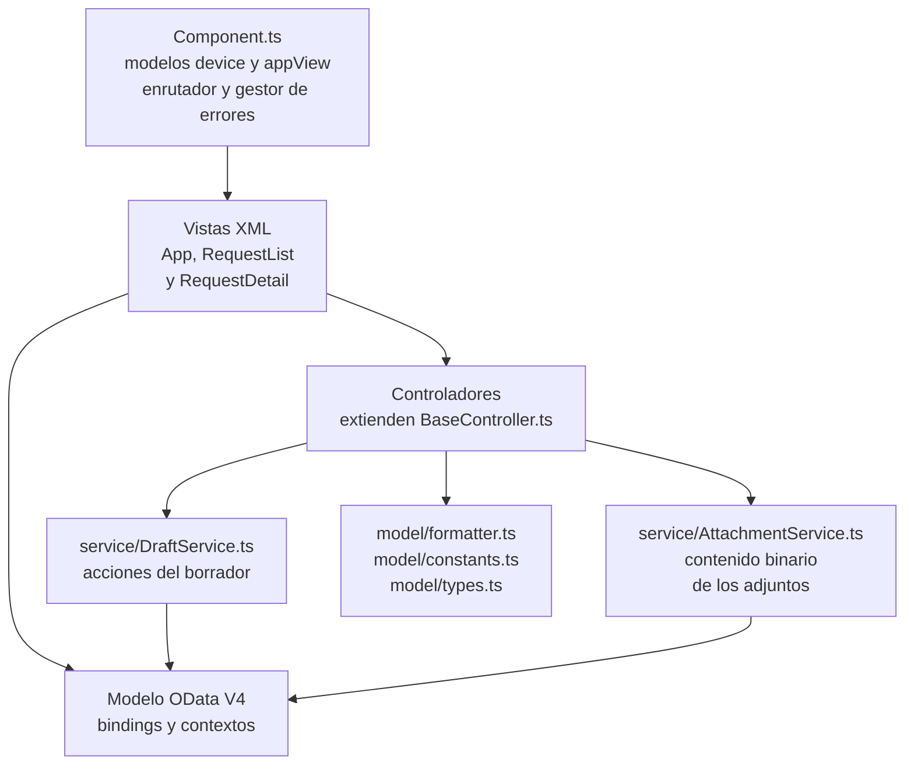
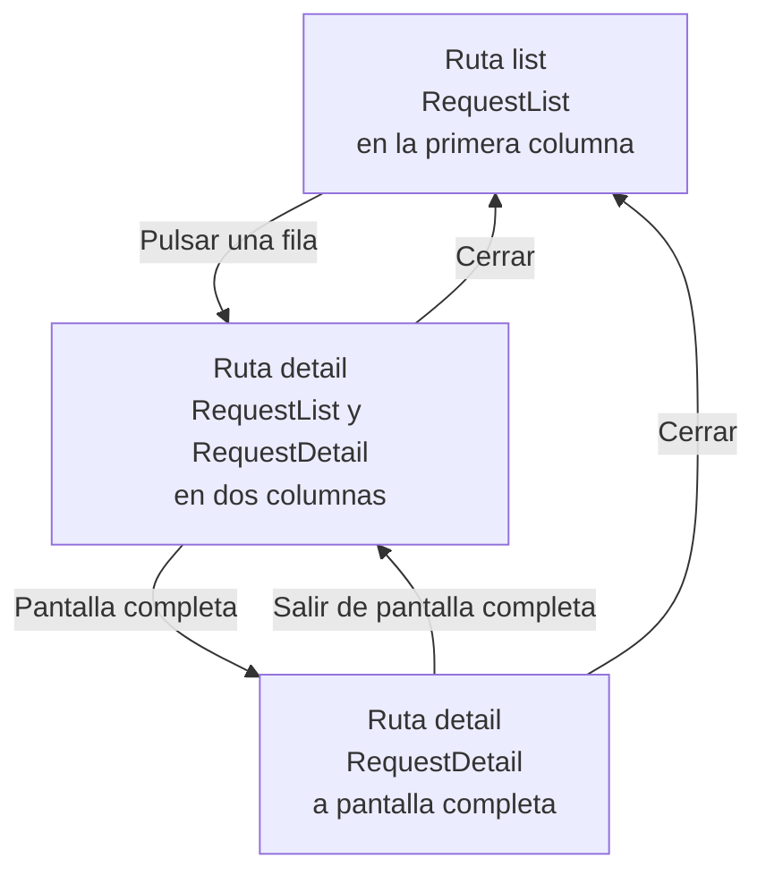
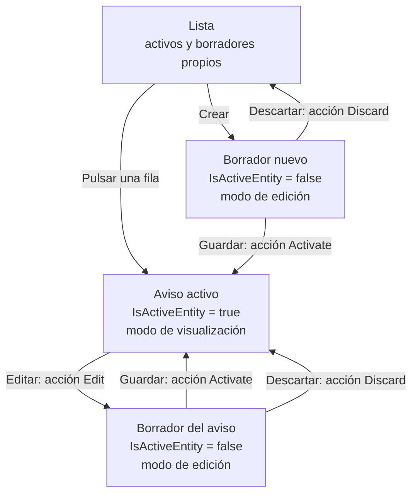

# Arquitectura de la aplicación "Avisos de mantenimiento"

Este documento fija la arquitectura de la aplicación `sapui5.maintenance` y las decisiones que las historias de usuario dan por hechas. La referencia completa del servicio está en `docs/servicio.md`; el razonamiento de cada decisión, en `docs/adr/`.

## 1. Datos generales

| Aspecto | Valor |
|---|---|
| Id de la aplicación | `sapui5.maintenance` |
| Tipo | SAPUI5 freestyle, TypeScript estricto, vistas XML |
| Versión de SAPUI5 | 1.148.0, tema `sap_horizon` |
| Librerías | `sap.m`, `sap.f`, `sap.uxap`, `sap.ui.core`, `sap.ui.layout`, `sap.ui.unified` |
| Modelo principal | `sap.ui.model.odata.v4.ODataModel`, modelo por defecto |
| Servicio | RAP OData V4 con borrador |
| Servidor simulado | `@sap-ux/ui5-middleware-fe-mockserver` |

## 2. Diagrama de componentes

La aplicación trabaja siempre contra la misma URL de servicio. Según el script de arranque, esa URL la atiende el sistema real, a través del proxy de desarrollo, o el servidor simulado.



Dentro de la aplicación, las responsabilidades se reparten así:



## 3. Servicio

| Dato | Valor |
|---|---|
| URL | `/sap/opu/odata4/sap/zui_mnt_request_o4/srvd/sap/zui_mnt_request/0001/` |
| Mandante | 250 |
| Definición de servicio | `ZUI_MNT_REQUEST` |
| Binding | `ZUI_MNT_REQUEST_O4` (OData V4, UI) |
| Espacio de nombres | `com.sap.gateway.srvd.zui_mnt_request.v0001` |
| Metadatos locales | `webapp/localService/mainService/metadata.xml` |

### 3.1 Conjuntos de entidades y claves

| Conjunto | Tipo de entidad | Clave | Borrador | Uso |
|---|---|---|---|---|
| `Requests` | `RequestsType` | `RequestUUID`, `IsActiveEntity` | Sí (raíz) | Avisos |
| `Tasks` | `TasksType` | `TaskUUID`, `IsActiveEntity` | Sí (nodo) | Operaciones del aviso (`_Task`) |
| `Parts` | `PartsType` | `PartUUID`, `IsActiveEntity` | Sí (nodo) | Repuestos del aviso (`_Part`) |
| `Attachments` | `AttachmentsType` | `AttachmentUUID`, `IsActiveEntity` | Sí (nodo) | Adjuntos del aviso (`_Attachment`) |
| `Plants` | `PlantsType` | `Plant` | No | Plantas con equipos (23) |
| `Equipments` | `EquipmentsType` | `Equipment` | No | Equipos vigentes |
| `Products` | `ProductsType` | `Product` | No | Materiales; los repuestos son `SP001` a `SP006` |
| `Statuses` | `StatusesType` | `Status` | No | Lista de estados |
| `Priorities` | `PrioritiesType` | `Priority` | No | Lista de prioridades |
| `RequestTypes` | `RequestTypesType` | `RequestType` | No | Lista de tipos de aviso |
| `RequestStats` | `RequestStatsType` | `Plant`, `Status`, `Priority` | No | Recuento de avisos activos |

Los metadatos contienen además el conjunto técnico `I_DraftAdministrativeData`, que no admite lectura directa: sus datos se obtienen por la navegación `DraftAdministrativeData` de las entidades con borrador.

### 3.2 Acciones

Todas las acciones están ligadas al tipo `RequestsType` y se invocan con su nombre completo, que incluye el espacio de nombres.

| Grupo | Acciones |
|---|---|
| Borrador | `Edit`, `Activate`, `Discard`, `Prepare`, `Resume` |
| Negocio | `assign`, `startWork`, `complete`, `reject` |

Parámetros, resultados y códigos de respuesta: `docs/servicio.md`.

### 3.3 Acceso en desarrollo

El fichero `ui5.yaml` configura el proxy de desarrollo (`fiori-tools-proxy`), que reenvía al sistema las peticiones cuya ruta empieza por `/sap`, con el mandante 250. La aplicación no contiene direcciones de servidor ni credenciales: el origen de datos del `manifest.json` es una ruta relativa al servidor que sirve la aplicación.

## 4. Estructura de carpetas objetivo de `webapp/`

| Ruta | Contenido |
|---|---|
| `Component.ts` | Componente: modelos `device` y `appView`, enrutador y gestor de errores |
| `manifest.json` | Origen de datos, modelos, librerías y rutas |
| `controller/` | `BaseController.ts`, `ErrorHandler.ts` y los controladores `App`, `RequestList` y `RequestDetail` |
| `view/` | Vistas `App`, `RequestList` y `RequestDetail`, y fragmentos |
| `model/` | `models.ts`, `formatter.ts`, `constants.ts` y `types.ts` (tipos de las entidades del servicio) |
| `service/` | `DraftService.ts` y `AttachmentService.ts` |
| `localService/` | `mainService/metadata.xml` y `mainService/data/` (datos del servidor simulado) |
| `i18n/` | `i18n.properties` (inglés) e `i18n_es.properties` (español) |
| `css/` | `style.css` |
| `test/` | Pruebas unitarias (`unit/`) y de integración (`integration/`) |

Reglas de la estructura:

- Todos los controladores extienden `controller/BaseController.ts`.
- El acceso a datos se hace con bindings y contextos del modelo OData V4. Solo `service/AttachmentService.ts` envía peticiones propias, para el contenido binario de los adjuntos.
- Los formateadores están en `model/formatter.ts`; las constantes de estados y prioridades, en `model/constants.ts`.
- Ningún texto visible se escribe en vistas ni en controladores: todos están en `i18n`, en inglés y en español.
- `webapp/localService/mainService/metadata.xml` y los ficheros de `docs/` no se modifican al implementar las historias.

## 5. Decisiones fijadas

### 5.1 Modelo

**Modelo** (por defecto, sin nombre):

```json
"dataSources": {
  "mainService": {
    "uri": "/sap/opu/odata4/sap/zui_mnt_request_o4/srvd/sap/zui_mnt_request/0001/",
    "type": "OData",
    "settings": {
      "odataVersion": "4.0",
      "localUri": "localService/mainService/metadata.xml"
    }
  }
},
"models": {
  "": {
    "dataSource": "mainService",
    "preload": true,
    "settings": {
      "operationMode": "Server",
      "autoExpandSelect": true,
      "earlyRequests": true,
      "groupId": "$auto"
    }
  }
}
```

El bloque `dataSources` pertenece a la sección `sap.app` del `manifest.json`; el bloque `models`, a la sección `sap.ui5`, junto al modelo `i18n` ya existente.

### 5.2 Rutas

**Rutas** (`sap.f.routing.Router`, control `sap.f.FlexibleColumnLayout` con id `fcl`):

| Ruta | Patrón | Columnas |
|---|---|---|
| `list` | `:?query:` | Lista en la primera columna |
| `detail` | `detail/{uuid}/{active}/:layout:` | Lista y detalle; `active` es `true` o `false` e indica si se muestra la entidad activa o el borrador |

Los parámetros `uuid` y `active` de la ruta `detail` son los dos componentes de la clave del aviso (`RequestUUID` e `IsActiveEntity`). El parámetro opcional `layout` contiene la disposición de columnas.



### 5.3 Otros modelos

**Otros modelos**: `i18n`, `device` y `appView` (JSONModel con `layout`, `busy` y `editable`).

| Modelo | Tipo | Contenido |
|---|---|---|
| `i18n` | `ResourceModel` | Textos de la aplicación |
| `device` | `JSONModel` | Información del dispositivo, con enlace en un solo sentido |
| `appView` | `JSONModel` | Estado de la interfaz: `layout` (disposición del control `fcl`), `busy` (indicador de ocupación) y `editable` (modo de edición) |

La propiedad `editable` no es una fuente de estado independiente: el modo de la pantalla depende de `IsActiveEntity` del aviso mostrado (apartado 6).

### 5.4 Vistas

**Vistas**: `App` (FCL), `RequestList` y `RequestDetail`.

| Vista | Contenido | Columna |
|---|---|---|
| `App` | `sap.f.FlexibleColumnLayout` con id `fcl` | Vista raíz |
| `RequestList` | Lista de avisos | Primera |
| `RequestDetail` | Detalle del aviso | Segunda |

## 6. Convenciones del borrador

El servicio gestiona el borrador. La aplicación no guarda datos intermedios por su cuenta: cada cambio en un campo se envía al borrador del servicio.

1. **Clave compuesta.** La clave de `Requests`, `Tasks`, `Parts` y `Attachments` incluye `IsActiveEntity`. Un mismo aviso puede existir a la vez como entidad activa (`IsActiveEntity=true`) y como borrador (`IsActiveEntity=false`), con el mismo `RequestUUID`.
2. **Lista.** La lista muestra los avisos activos y los borradores del usuario, sin duplicados, con este filtro fijo:

   ```text
   IsActiveEntity eq false or SiblingEntity/IsActiveEntity eq null
   ```

3. **Modo de la pantalla.** El modo de visualización o de edición del detalle depende de `IsActiveEntity` del contexto mostrado, no de una variable propia de la aplicación.
4. **Lógica encapsulada.** La lógica del borrador está en `webapp/service/DraftService.ts`. Los controladores no construyen nombres de acciones ni contienen el espacio de nombres del servicio.
5. **Descartar.** Un borrador se descarta con la acción `Discard`. El servicio rechaza `DELETE` sobre un borrador raíz.



## 7. Servidor simulado

El servidor simulado permite desarrollar y probar sin conexión al sistema. Atiende la misma URL que el servicio real, de modo que la aplicación no cambia entre un modo y otro.

| Elemento | Valor |
|---|---|
| Paquete | `@sap-ux/ui5-middleware-fe-mockserver` (dependencia de desarrollo) |
| Configuración | `ui5-mock.yaml` |
| Scripts | `npm run start-mock` y `npm run start-mock-noflp` |
| Metadatos | `webapp/localService/mainService/metadata.xml` |
| Datos | Un fichero JSON por conjunto de entidades en `webapp/localService/mainService/data/` |

`ui5-mock.yaml` equivale a `ui5.yaml` sin el bloque `backend` y con el middleware del servidor simulado:

```yaml
    - name: sap-fe-mockserver
      beforeMiddleware: csp
      configuration:
        mountPath: /
        services:
          - urlPath: /sap/opu/odata4/sap/zui_mnt_request_o4/srvd/sap/zui_mnt_request/0001
            metadataPath: ./webapp/localService/mainService/metadata.xml
            mockdataPath: ./webapp/localService/mainService/data
            generateMockData: false
        annotations: []
```

| Script | Fichero de configuración | Origen de los datos |
|---|---|---|
| `npm run start` | `ui5.yaml` | Servicio real, a través del proxy |
| `npm run start-noflp` | `ui5.yaml` | Servicio real, a través del proxy |
| `npm run start-mock` | `ui5-mock.yaml` | Servidor simulado |
| `npm run start-mock-noflp` | `ui5-mock.yaml` | Servidor simulado |

Los datos simulados proceden del servicio real: 60 avisos (`10000001` a `10000060`) de las plantas 2410, 1010, 1210, 1710 y 5510, con sus operaciones, repuestos y adjuntos, además de las plantas, los equipos de esas cinco plantas, los materiales y las listas de códigos.

Cada historia se verifica en los dos modos: contra el servicio real y contra el servidor simulado.
