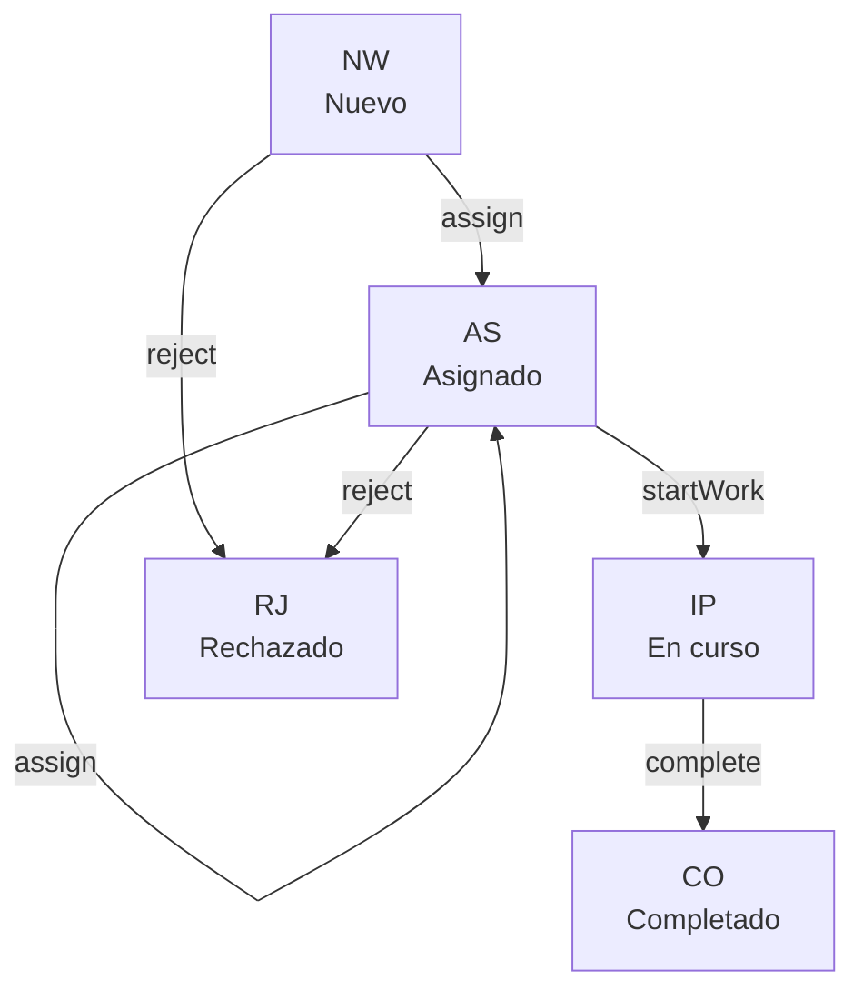

# Avisos de mantenimiento: resumen del proyecto

| Dato | Valor |
|---|---|
| Nombre del proyecto | Avisos de mantenimiento |
| Código | MNT |
| Aplicación | `sapui5.maintenance`, SAPUI5 freestyle en TypeScript |
| Servicio | RAP OData V4 con borrador, sobre SAP S/4HANA |

## 1. Cliente y problema

El cliente es un grupo industrial con 23 plantas. Las averías de sus equipos se gestionan por teléfono y con hojas de cálculo. Esta forma de trabajo tiene tres consecuencias:

- No existe trazabilidad de las averías ni de su resolución.
- Los repuestos se piden tarde.
- No se conoce el tiempo de parada real de los equipos.

El departamento de mantenimiento encarga una aplicación web para registrar y tramitar los avisos de mantenimiento sobre los datos maestros de su sistema SAP S/4HANA.

## 2. Objetivos

1. Registrar cada avería como un aviso asociado a una planta y a un equipo, con su descripción, su prioridad y sus adjuntos.
2. Dar trazabilidad al aviso durante todo su ciclo de vida: quién lo notifica, a quién se asigna, cuándo se inicia y cuándo se completa o se rechaza.
3. Registrar las operaciones y los repuestos de cada intervención, con el coste estimado calculado por el sistema.
4. Registrar las horas de parada y la resolución al completar el aviso.
5. Ofrecer indicadores por planta, estado y prioridad.

## 3. Alcance

La aplicación cubre las ocho historias de usuario del apartado 6:

- Lista de avisos con búsqueda, filtros, ordenación y recuento, incluidos los borradores del usuario.
- Detalle del aviso con operaciones, repuestos y adjuntos.
- Creación y edición con borrador: guardado automático, activación, descarte y reanudación.
- Adjuntos: ficheros e imágenes, vista previa, descarga y captura con la cámara del dispositivo.
- Acciones de negocio (asignar, iniciar, completar y rechazar), habilitadas según el estado del aviso.
- Ayudas de búsqueda sobre los datos maestros: planta, equipo dependiente de la planta y material.
- Cuadro de indicadores con gráficos.

La aplicación consume un único servicio OData V4, descrito en `docs/servicio.md`. La arquitectura y las decisiones técnicas están en `docs/arquitectura.md` y en `docs/adr/`.

## 4. Usuarios

| Rol | Necesidad |
|---|---|
| Operario de planta | Registrar una avería sobre un equipo, con fotos |
| Planificador | Revisar los avisos, asignarlos a un técnico o rechazarlos |
| Técnico | Ver sus avisos, registrar operaciones y repuestos, cerrar la intervención |
| Responsable de mantenimiento | Consultar indicadores por planta, estado y prioridad |

## 5. Ciclo de vida del aviso

Un aviso nace en estado Nuevo. El estado no se modifica como un campo: cambia solo mediante las acciones del servicio.

| Estado | Texto | Acciones disponibles | Modificable |
|---|---|---|---|
| `NW` | Nuevo | `assign`, `reject` | Sí |
| `AS` | Asignado | `assign` (reasignación), `startWork`, `reject` | Sí |
| `IP` | En curso | `complete` | Sí |
| `CO` | Completado | Ninguna | No |
| `RJ` | Rechazado | Ninguna | No |

Un aviso solo se puede borrar en estado `NW` y por el usuario que lo creó.

## 6. Historias de usuario

| Historia | Paso | Descripción | Entrega |
|---|---|---|---|
| HU-01 | 44 | Aplicación conectada al sistema real, con arquitectura base | Sesión de trabajo conjunta |
| HU-02 | 45 | Lista de avisos con búsqueda, filtros, ordenación y contador, incluidos los borradores propios | Sesión de trabajo conjunta |
| HU-03 | 46 | Detalle del aviso con operaciones, repuestos y adjuntos | Sesión de trabajo conjunta |
| HU-04 | 47 | Crear y editar con borrador: guardar, descartar y reanudar | Sesión de trabajo conjunta |
| HU-05 | 48 | Adjuntos: subir ficheros e imágenes, vista previa, descarga y captura con cámara | Sesión de trabajo conjunta |
| HU-06 | 49 | Acciones de negocio con parámetros y control dinámico por estado | Tarea del sprint |
| HU-07 | 50 | Ayudas de búsqueda sobre datos maestros (planta, equipo dependiente, material) | Tarea del sprint |
| HU-08 | 51 | Cuadro de indicadores con gráfico y librería externa | Tarea del sprint |

El texto completo de cada historia, con sus criterios de aceptación, está en `docs/especificacion/HU-NN.md`. Las historias se implementan en orden: cada una parte del resultado de la anterior.

## 7. Definición de terminado

Una historia está terminada cuando se cumplen todas estas condiciones:

1. Cumple todos los criterios de aceptación de la historia.
2. `npm run ts-typecheck`, `npm run lint` y `npx @ui5/linter` terminan sin errores.
3. Está verificada en el navegador contra el servicio real y contra el servidor simulado.
4. Los textos están en `i18n`, en inglés y en español, sin literales en vistas ni controladores.
5. No usa API obsoletas: cada API se consulta antes en la referencia de la API de SAPUI5 de la versión del proyecto (1.148).
6. Tiene su commit en la rama de la historia, con mensaje convencional.

## 8. Fuera de alcance

- Autorizaciones por rol: la aplicación no distingue roles. La disponibilidad de cada operación depende del estado del aviso y la decide el servicio.
- Integración con órdenes de mantenimiento estándar.
- Uso sin conexión.
